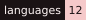

<div align="center">


# Amada

**A small decision model that reads a text and answers your questions with probabilities**


[](https://onnxruntime.ai/)


[](https://huggingface.co/jhu-clsp/mmBERT-base)


[](LICENSE)

<br>

**Big AI models write long answers when your code only needs a decision: yes or no, which option, how much.**

**Amada gives you that decision on your own CPU, in tens of milliseconds, with a probability you can trust.**

*Built by Liam DB — with the help of AI.*

[🌐 Website](https://amada.devliam.com) · [⬇️ Download](https://github.com/DevLiamDb/Amada/releases/latest) · [📊 Benchmark](https://amada.devliam.com/benchmark) · [📜 Changelog](CHANGELOG.md)

</div>

---

<div align="center">


*Real outputs of Amada 3.1, nothing retouched. "Is the customer happy?" gets **INFO NOT PROVIDED**: the message does not say, so Amada does not guess.*

</div>

---

> Amada does **not** write text. You give it a text and one or more questions, it returns numbers your code can use directly: the probability of yes, a share for every option, a level on a scale, and the probability that **the text simply does not say**.

<div align="center">
<table>
<tr>
<td align="center" width="16%">

**🎯 Three questions**<br>
yes / no, pick one,<br>
level on a scale

</td>
<td align="center" width="16%">

**🤷 Says "I don't know"**<br>
When the text gives<br>
no answer, it says so<br>
instead of guessing

</td>
<td align="center" width="16%">

**📏 Calibrated**<br>
When it says 80 %,<br>
it is right about<br>
80 % of the time

</td>
<td align="center" width="16%">

**🏠 100% local**<br>
CPU only, no GPU,<br>
no internet, no account

</td>
<td align="center" width="16%">

**⚡ Fast**<br>
~40 ms for a short<br>
yes / no question<br>
on a laptop CPU*

</td>
<td align="center" width="16%">

**🌍 12 languages**<br>
English + 11 others,<br>
up to 8,192 tokens

</td>
</tr>
</table>
</div>

---

## Why Amada

We ran **Jev 1.14** (TypeSafe's closed decision model) on 8 November 2026, and Amada on exactly the same texts, the same questions and the same options.

| | Jev 1.14 (paid API) | Amada 4.0 |
|---|:---:|:---:|
| Where it runs | TypeSafe's servers | **your own CPU** |
| Price | $0.042 per million tokens | **free** |
| Your text leaves your machine | yes | **never** |
| One short yes / no question | ≈ 245 ms (internet included) | **≈ 40 ms** (×6 faster)* |
| Voice request, 60 intents | **≈ 270 ms** | ≈ 390 ms |
| Prompt injection (116 messages) | 0.733 | **0.845** |
| Reading, 11 languages (Belebele) | **0.947** | 0.554 |
| Public datasets where it wins | **6 of 7** | 1 of 7 |

\* Median time on one laptop (Intel Core i5-11400H, 4 CPU threads, ONNX Runtime), measured with 4.0 on 12 November 2026: 41 ms for one line of screen text, 54 ms for a short note. It depends on your processor, on the length of the text and on the number of options: 60 options take ~390 ms. Method: [methodology](https://amada.devliam.com/methodology.pdf).

Amada is **not** better everywhere: Jev is far more accurate on reading, in every language, and on 6 of 7 public datasets. Amada wins on speed for short questions, on price, on privacy, and on prompt injection. Every number, the good ones and the bad ones, is on the [benchmark page](https://amada.devliam.com/benchmark).

---

## What it's useful for

- **Moderation:** "Is this message an insult?", "Is this a prompt injection?" before it reaches your app or your LLM.
- **Sorting:** route emails, tickets or reviews to the right team or category, with a probability for each.
- **Screening before an expensive step:** ask one cheap yes / no question first, call the big model only when needed.
- **Privacy-sensitive text:** notes and messages that must not leave the machine.
- **Bots and games:** a Discord bot, a game character or a home automation that reacts to what people type.
- **Small machines:** the INT4 version needs about 1.2 GB of RAM.

> ⚠️ Never use Amada for medical, legal, financial, safety or other important decisions about real people. It is an experimental model made by one person.

---

## Installation

> Requirements: **Python 3** and **pip**.

```bash
git clone https://github.com/DevLiamDb/Amada.git
cd Amada
pip install -r requirements.txt
```

Then get the model:

1. Download `amada-4.0.zip` from the [latest release](https://github.com/DevLiamDb/Amada/releases/latest) (or the smaller `amada-4.0-int4.zip`, 188 MB, from the same release).
2. Unzip it into a `Release/` folder next to `play.py`, so you get `Release/amada-4.0/amada_model.onnx` and `Release/amada-4.0/tokenizer/`.

> ⚠️ **Keep the `tokenizer/` folder next to `amada_model.onnx`.** Without it, the answers come out wrong.

---

## Usage

### 1. In the terminal

```bash
python play.py
```

Paste a text, press Enter on an empty line, then ask questions:

```text
Did Lea eat an apple?                          -> yes / no
Which apple did she eat? | red, green, yellow  -> choice
How hungry is she? #                           -> score (none / low / moderate / high)
How happy is she? # not at all, a bit, very    -> score with your own levels
:new = new text    :q = quit
```

Other versions: `python play.py --version 4.0-int4` (needs onnxruntime 1.20+), `python play.py --version 3.1`, `python play.py --version 2.0`...

### 2. From Python

```python
from play import Amada, release_model

amada = Amada(release_model("4.0"))
answers, cut = amada.ask(
    "BOOM. Three knocks on my door. Then nothing.",
    [{"type": "noul", "text": "Is it my mother knocking?"},
     {"type": "score", "text": "How scary is it?", "levels": ["none", "low", "moderate", "high"]}],
)
print(answers)   # [{'p_yes': ..., 'p_unknown': ...}, {'probs': {'none': ..., ...}}]
```

### 3. The three kinds of question

| Type | You ask | Amada returns |
|---|---|---|
| **yes / no** (`noul`) | `Did the customer pay by card?` | probability of yes, plus the probability that **the text does not say** |
| **choice** | `What does the customer want? \| a refund, an exchange, ...` | one probability per option, 100 % in total |
| **score** | `How urgent is it? #` | one probability per level (none, low, moderate, high, or your own levels) |

It only knows the text you give it. No internet, no memory, no text generation.

---

## Downloads

Every version is a [release](https://github.com/DevLiamDb/Amada/releases): one zip with the ONNX model and its tokenizer.

| Version | Base model | Max length | Zip | Notes |
|---|---|:---:|:---:|---|
| **4.0** (current) | mmBERT-base | 8,192 | 1.16 GB | messy writing, "the text does not say", TREC |
| **4.0 INT4** | mmBERT-base | 8,192 | **188 MB** | same model, 4-bit weights: 4× less RAM, about 1 point lower on AG News and Banking77 |
| 3.1 | mmBERT-base | 8,192 | 1.16 GB | near-neighbour labels, a little better on Banking77 and emotion |
| **3.1 INT4** | mmBERT-base | 8,192 | **188 MB** | same model, 4-bit weights: same accuracy, 3× less RAM |
| 3.0.1 | mmBERT-base | 8,192 | 1.16 GB | 3.0 recalibrated, same accuracy |
| 3.0 | mmBERT-base | 8,192 | 1.16 GB | long texts, many options, trap texts |
| 2.0 | mmBERT-base | 512 | 1.16 GB | multilingual, "the text does not say" |
| 1.0 | ModernBERT-large | 512 | 1.49 GB | first version, English only |

What changed in each one: [CHANGELOG.md](CHANGELOG.md).

---

## Benchmarks

<div align="center">


</div>

**Our own short tests** (English: 2,000 texts · 11 languages: 1,320 texts):

| Accuracy | Yes / no | Choice | Score | English, all types | 11 languages |
|---|:---:|:---:|:---:|:---:|:---:|
| **Amada 4.0** | 0.961 | 0.908 | 0.759 | 0.896 | 0.985 |
| Amada 4.0 INT4 | 0.960 | 0.908 | 0.742 | 0.892 | 0.983 |
| Amada 3.1 | 0.961 | 0.915 | 0.760 | 0.899 | 0.984 |

Calibration error of 4.0 (ECE, lower is better), on the half of the English tests kept out of calibration: yes / no 0.009, choice 0.016, score 0.048 (4.0 INT4: 0.008, 0.014, 0.031).

**"The text does not say"** (yes / no / not stated, 939 held-out questions): 4.0 gets **0.963** (3.1: 0.917), and **0.954** on the same texts with typos (3.1: 0.889). These texts also helped fit the calibration, so this is a check, not an independent test.

**Public datasets, zero-shot** (Amada never saw them in training: it only gets the question and the option names). Jev 1.14 run by us on the same texts:

| Dataset | Task | Amada 4.0 | Amada 4.0 INT4 | Amada 3.1 | Jev 1.14 |
|---|---|:---:|:---:|:---:|:---:|
| SST-2 | movie review sentiment | 0.897 | 0.890 | 0.899 | **0.959** |
| AG News | news topic, 4 labels | 0.803 | 0.793 | 0.800 | **0.883** |
| Banking77 | bank support intent, 77 labels | 0.586 | 0.574 | 0.611 | **0.788** |
| emotion | emotion of a tweet, 6 labels | 0.447 | 0.464 | 0.471 | **0.595** |
| tweet_topic | topic of a tweet | 0.718 | 0.711 | 0.740 | **0.820** |
| Prompt injection | is this text an attack on an AI? | **0.845** | 0.810 | **0.845** | 0.733 |
| When2Call | should an AI agent call a tool? | 0.344 | 0.340 | 0.324 | **0.733** |

**Public tests in 11 languages** (average, the same items in every language):

| Test | Amada 4.0 | Amada 4.0 INT4 | Amada 3.1 | Jev 1.14 |
|---|:---:|:---:|:---:|:---:|
| Yes / no (machine-translated) | 0.841 | 0.837 | 0.839 | **0.882** |
| Reading (Belebele, 4 answers) | 0.554 | 0.559 | 0.568 | **0.947** |
| Intents (MASSIVE, 60 options) | 0.834 * | 0.829 * | 0.428 | 0.824 |

\* Not zero-shot: Amada 4.0 learned from MASSIVE's training split (the test items stay unseen).

**4.0 INT4** was run on 12 November 2026 on exactly the same items as 4.0 (on CPU instead of GPU). Compared answer by answer (exact McNemar test), the clear differences are AG News (-1.0 point), Banking77 (-1.2), scores (-1.6) and emotion (+1.7); the others are within chance, including prompt injection (116 texts only).

**Speed** (median time for one answer, one request at a time, the same requests for all · Amada on an Intel Core i5-11400H, 4 CPU threads · Jev through its API from France). 4.0 and 4.0 INT4 were measured on 12 November 2026, Jev on 8 November:

| Request | Amada 4.0 | Amada 4.0 INT4 | Jev 1.14 |
|---|:---:|:---:|:---:|
| One line of screen text, yes / no | 41 ms | **37 ms** | 244 ms |
| Short note, yes / no | 54 ms | **49 ms** | 247 ms |
| Reading passage, 4 answers | 161 ms | 159 ms | 264 ms |
| Voice request, 60 intents | 390 ms | 375 ms | **270 ms** |

In the same run as INT4, 4.0 took 40, 55, 154 and 388 ms: INT4 is about as fast (a little faster on short questions, a little slower on reading). It mostly saves memory: about 340 MB of RAM after loading instead of 1.4 GB.

**Weak spots**, named on purpose: TREC (kind of answer a question expects, 0.52 in 4.0, up from 0.39), Banking77 (0.59, 2.5 points below 3.1), ordinal scores (about 76 %) and very long texts. Messy writing now costs little: held-out yes / no with typos 0.960 in English and 0.967 in 11 languages.

> **Honest note:** our short tests use answers from a strong AI (GPT-6 Luna), not from human annotators, and their texts look like the training data. The public datasets use human labels.

---

<details>
<summary><b>🗂️ File structure</b></summary>
<br>

```
Amada/
├── play.py            ← terminal chat + Python API ← START HERE
├── requirements.txt   ← numpy, onnxruntime, transformers
├── Release/           ← unzip the downloaded versions here (not in the repository)
│   └── amada-4.0/
│       ├── amada_model.onnx
│       └── tokenizer/  ← keep it next to the ONNX
├── CHANGELOG.md       ← what changed in each version
├── LICENSE            ← MIT
├── NOTICE.md          ← notices of the base models (keep them when sharing)
└── media/             ← logo, badges and GIFs
```

</details>

---

<details>
<summary><b>⚙️ How it works inside</b></summary>
<br>

```
text + questions ──► tokenizer ──► encoder (mmBERT-base, ONNX, CPU) ──► one head per question type
                                                                     │
                                                                     └── temperatures ──► calibrated probabilities
```

- **One pass for all questions:** the text and every question are read together. Each question starts with a `[Q]` marker, each option with `[OPT]`, each level with `[LVL]`.
- **Three kinds of answer:** yes / no (with "the text does not say"), choice (one score per option, shared to 100 %), score (one probability per level).
- **Calibration:** since 3.0.1, the temperatures depend on the length of the text and on the number of options. That is why a "95 %" from Amada means about 95 %.
- **Time grows with the options:** every option is read. Two options take ~40 ms, 77 options ~720 ms.

</details>

---

<details>
<summary><b>❓ FAQ</b></summary>
<br>

**Can I use Amada in a company or a paid product?**
Yes. Amada is MIT licensed: commercial use is allowed. Keep the copyright line and the license text with the files.

**Can I fine-tune it?**
Yes, and you may share or sell your fine-tuned version too. Keep the MIT notice (and NOTICE.md) with it.

**Which version should I use?**
4.0 for most uses. 4.0 INT4 if you need a small download or little RAM (about 1 point lower on some classification tasks), or 3.1 if your task looks like Banking77 or emotion. The older versions are there to compare.

**How many options can a choice question have?**
Two or more, no fixed maximum: the text, the question and the options must fit together in 8,192 tokens. 3.0 and later were trained with lists of up to 386 options.

**What hardware do I need?**
A normal CPU. About 9 seconds to load and about 1.4 GB of RAM after loading (FP32); about 1.2 GB at most with INT4. No GPU, no internet once downloaded.

**Is there an API or a hosted version?**
No. Amada runs on your own computer.

**The answers look wrong.**
Check that the `tokenizer/` folder is next to `amada_model.onnx`.

</details>

---

## Story & credits

<details>
<summary><b>📖 The website: one night, 03:00 to 07:12</b></summary>
<br>

The [website](https://amada.devliam.com) presents Amada through a short story: one night, a girl who cannot sleep, a park, a hotel corridor, a flooded home, knocks on a door. In each scene, a diary text and a question are shown with **Amada's real answer**, computed in advance on those exact texts. Then she wakes up, turns on her computer, and a 90s desktop shows the benchmarks. No jump scares.

<div align="center">


</div>

</details>

<details>
<summary><b>🙏 Credits — who and what made Amada</b></summary>
<br>

Amada was **built with AI, and we say it plainly.**

| Who | Role |
|---|---|
| **Liam DB** ([DevLiamDb](https://github.com/DevLiamDb)) | Creator. The idea, the direction, the decisions, the training runs, the testing. |
| **[Claude Code](https://claude.com/claude-code)** (Anthropic) | Helped write the code (training, benchmarks, `play.py`, website) under Liam DB's direction. |
| **GPT-6 Luna** | Wrote a large part of the training examples and the reference answers of the short tests. |
| **[mmBERT-base](https://huggingface.co/jhu-clsp/mmBERT-base)** (Johns Hopkins University, CLSP) | The base network of Amada 2.0 and later (MIT). |
| **[ModernBERT-large](https://huggingface.co/answerdotai/ModernBERT-large)** (Answer.AI) | The base network of Amada 1.0 (Apache-2.0). |

**Trained on:** public texts (Wikipedia, FineWeb-2, Project Gutenberg, government reports, arXiv and PubMed abstracts), public labelled datasets (QuALITY, ContractNLI, Qasper, CLINC150) and synthetic examples. Never on the benchmark test sets.

**Built on:** [ONNX Runtime](https://onnxruntime.ai/), [Hugging Face Transformers](https://huggingface.co/docs/transformers), [Kaggle](https://www.kaggle.com/) (training and benchmarks).

**Find the creator:** 🌐 [amada.devliam.com](https://amada.devliam.com) · 🐙 [GitHub](https://github.com/DevLiamDb)

</details>

---

## License

**Amada: MIT** (weights, `play.py` and every file of this repository)

✅ Use it for anything, commercial use included
✅ Modify it, fine-tune it, merge it
✅ Share or sell the original or your modified versions
📌 Keep the copyright line ("Copyright (c) 2026 LiamDB") and the license text with the files

The MIT license applies to every Amada version, 1.0 to the latest, including copies downloaded when the weights were
under CC BY-NC-ND 4.0. Amada comes with no warranty. The notices of mmBERT-base (MIT) and ModernBERT-large (Apache-2.0)
are in [NOTICE.md](NOTICE.md) and must be kept when you share the files. See [LICENSE](LICENSE) for the full terms.

---

<div align="center">


Built by Liam DB — with the help of AI. · liamdb.work@gmail.com

</div>
