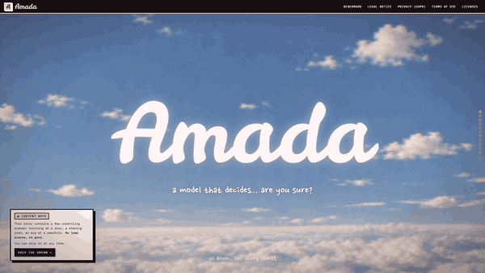
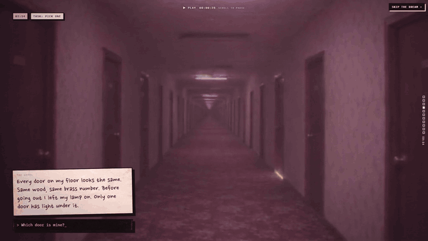
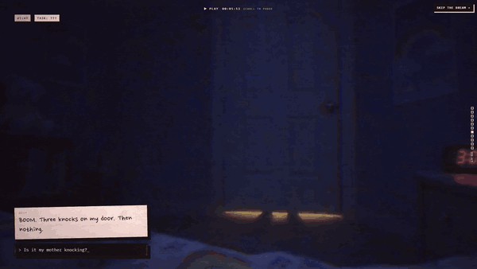

<p align="center">
  
</p>

<h1 align="center">Amada</h1>

<p align="center">
  <b>A small decision model. It does not write text: it reads a text and a question, and answers with probabilities.</b><br>
  CPU only · about 120 ms per text · English + 11 other languages · calibrated
</p>

<p align="center">
  <a href="https://github.com/DevLiamDb/Amada/releases/latest">Download</a> ·
  <a href="CHANGELOG.md">Changelog</a> ·
  <a href="#benchmarks">Benchmarks</a> ·
  <a href="#license">License</a>
</p>

---

<p align="center"></p>

<p align="center"><sub>Real outputs of Amada 3.1, nothing retouched. "Is the customer happy?" gets
<b>INFO NOT PROVIDED</b>: the message does not say, so Amada does not guess.</sub></p>

## What it does

Give Amada a text and one or more questions. Three kinds of question:

| Type | You ask | Amada returns |
|---|---|---|
| **yes / no** (`noul`) | `Did the customer pay by card?` | probability of yes, plus the probability that **the text does not say** |
| **choice** | `What does the customer want? \| a refund, an exchange, ...` | one probability per option, 100 % in total |
| **score** | `How urgent is it? #` | one probability per level (none, low, moderate, high, or your own levels) |

It only knows the text you give it. No internet, no memory, no text generation.
Its answers are probabilities, not facts: when it says 80 %, it is right about 80 % of the time (that is what
"calibrated" means, see [Benchmarks](#benchmarks)).

## Quick start

```bash
pip install -r requirements.txt
```

1. Download `amada-3.1.zip` from the [latest release](https://github.com/DevLiamDb/Amada/releases/latest).
2. Unzip it into a `Release/` folder next to `play.py`, so you get `Release/amada-3.1/amada_model.onnx` and
   `Release/amada-3.1/tokenizer/`. **Keep the tokenizer folder next to the ONNX**: without it, the answers come out wrong.
3. Run:

```bash
python play.py
```

Paste a text, press Enter on an empty line, then ask questions:

```text
Did Lea eat an apple?                          -> yes / no
Which apple did she eat? | red, green, yellow  -> choice
How hungry is she? #                           -> score (none / low / moderate / high)
How happy is she? # not at all, a bit, very    -> score with your own levels
:new = new text    :q = quit
```

Older versions: `python play.py --version 2.0` (after unzipping `amada-2.0.zip` into `Release/`).

From Python:

```python
from play import Amada, release_model

amada = Amada(release_model("3.1"))
answers, cut = amada.ask(
    "BOOM. Three knocks on my door. Then nothing.",
    [{"type": "noul", "text": "Is it my mother knocking?"},
     {"type": "score", "text": "How scary is it?", "levels": ["none", "low", "moderate", "high"]}],
)
print(answers)   # [{'p_yes': ..., 'p_unknown': ...}, {'probs': {'none': ..., ...}}]
```

## Downloads

Every version is a [release](https://github.com/DevLiamDb/Amada/releases): one zip with the ONNX model and its tokenizer.

| Version | Base model | Max length | Zip | Notes |
|---|---|---|---|---|
| **3.1** (current) | mmBERT-base | 8,192 | 1.16 GB | near-neighbour labels, best calibration |
| 3.0.1 | mmBERT-base | 8,192 | 1.16 GB | 3.0 recalibrated, same accuracy |
| 3.0 | mmBERT-base | 8,192 | 1.16 GB | long texts, many options, trap texts |
| 2.0 | mmBERT-base | 512 | 1.16 GB | multilingual, "the text does not say" |
| 1.0 | ModernBERT-large | 512 | 1.49 GB | first version, English only |

What changed in each one: [CHANGELOG.md](CHANGELOG.md).

## Benchmarks

<p align="center"></p>

Amada 3.1, short tests (English: 2,000 texts, 11 languages: 1,320 texts):

| | Yes / no | Choice | Score | English, all types | 11 languages |
|---|---|---|---|---|---|
| Accuracy | 0.961 | 0.915 | 0.760 | 0.899 | 0.984 |
| Calibration error (ECE, lower is better) | 0.004 | 0.016 | 0.032 | | |

Public datasets, **zero-shot** (Amada never saw them in training; it only gets the question and the option names):

| Dataset | Task | Amada 3.1 | Jev 1.14 (closed, as published) |
|---|---|---|---|
| SST-2 | movie review sentiment | 0.899 | 0.954 |
| AG News | news topic, 4 labels | 0.800 | 0.843 |
| Banking77 | bank support intent, 77 labels | 0.611 | 0.800 |
| emotion | emotion of a tweet, 6 labels | 0.471 | 0.587 |
| tweet_topic | topic of a tweet | 0.740 | 0.793 |
| Prompt injection | is this text an attack on an AI? | 0.845 | 0.965 |
| When2Call | should an AI agent call a tool? | 0.324 | — |

Jev is ahead on every dataset where it has a score. Amada runs on a laptop CPU; Jev is a hosted service.

**Weak spots**, named on purpose: TREC (kind of answer a question expects, 0.39), Banking77 (0.61), ordinal scores
(76 %) and very long texts. Messy writing (typos, SMS spelling, lost accents) costs 1.2 points in English and 2.2 points
in other languages.

**Honest note**: the short tests use answers from a strong AI (GPT-6 Luna), not from human annotators. They measure
how close Amada is to that teacher. The public datasets use human labels.

Every number, version by version and against other decision models: the Benchmark page of the website.

## Limits

- Experimental model made by one person. Not a finished product, not certified for any use.
- **Never use it for medical, legal, financial, safety or other important decisions about real people.**
- It can be wrong, including when it looks very sure.

<p align="center"></p>

## License

- **Amada model weights** (the release zips): [CC BY-NC-ND 4.0](LICENSE). Free for non-commercial use, with credit
  ("Amada by LiamDB" and a link to the license). No commercial use, and no sharing of modified or fine-tuned versions.
  Research, learning, personal projects and tests are welcome. For any other use, ask: permission can be discussed.
- Amada 2.0 and later are fine-tuned from [mmBERT-base](https://huggingface.co/jhu-clsp/mmBERT-base) (MIT);
  Amada 1.0 from [ModernBERT-large](https://huggingface.co/answerdotai/ModernBERT-large) (Apache-2.0).
  Their notices are in [NOTICE.md](NOTICE.md) and must be kept when you share the files.
- `play.py` and the files of this repository: same license as the weights (CC BY-NC-ND 4.0).

## Contact

LiamDB · liamdb.work@gmail.com

<p align="center"></p>
